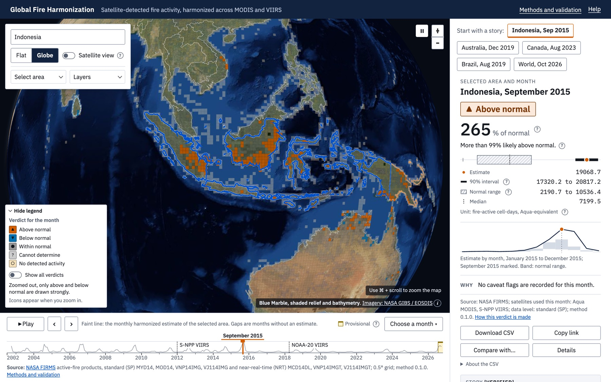
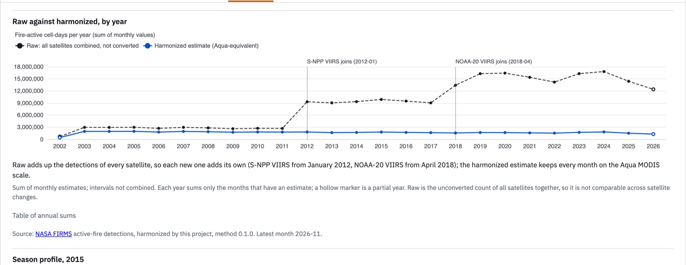
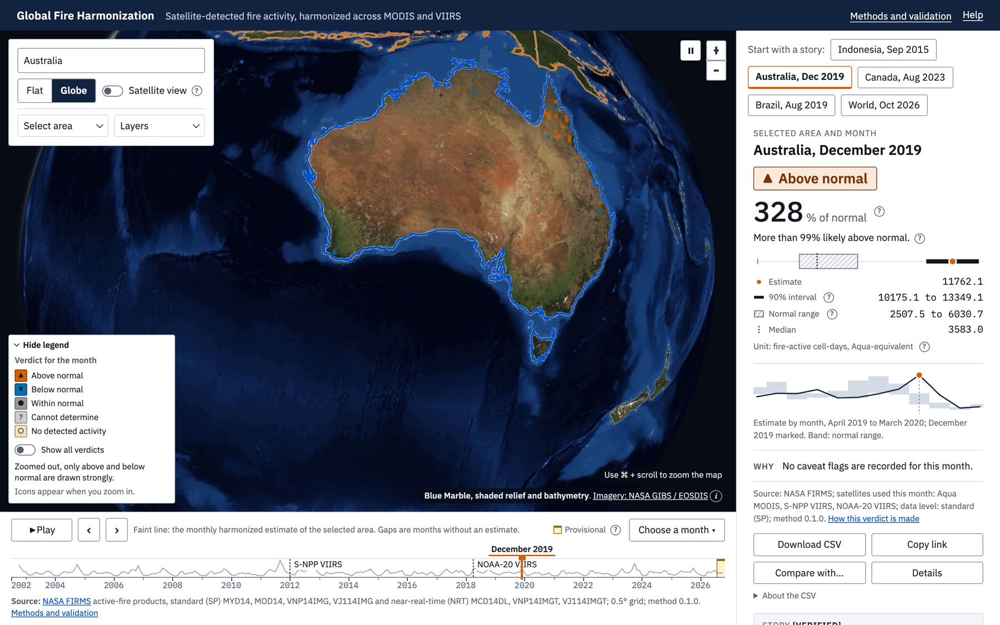
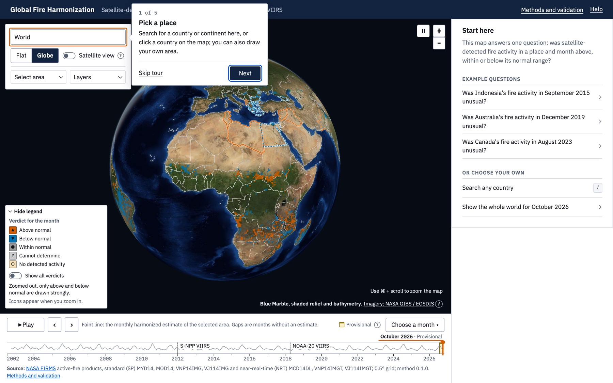
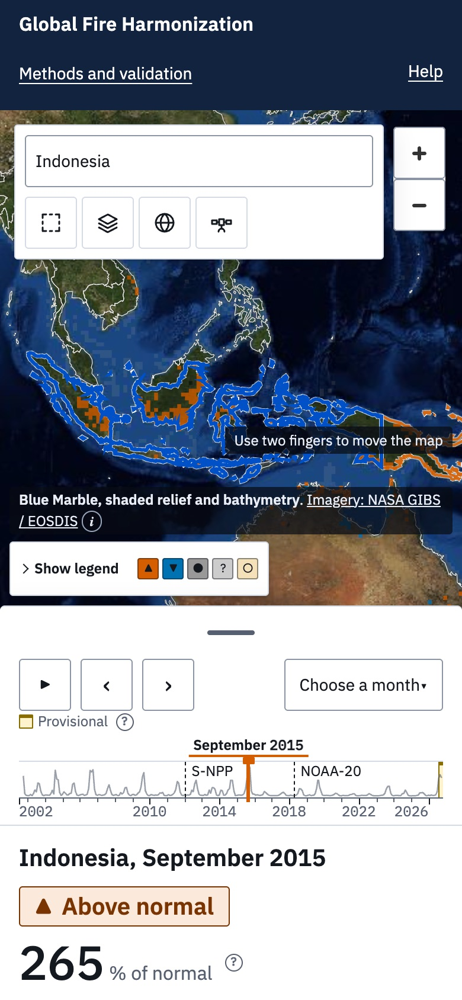
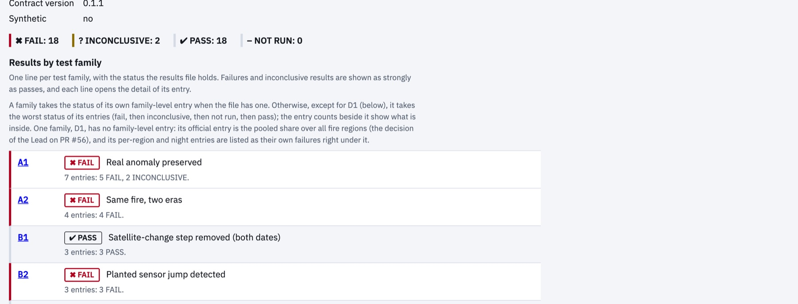

# Global Fire Harmonization (*Many Witnesses*)

**NASA Space Apps Challenge 2026** · Challenge: **[Harmonization of MODIS and VIIRS Hot Spots](https://www.spaceappschallenge.org/2026/challenges/modis-and-viirs-hot-spots/)**

> **Did fire activity really change here, or only the satellites watching it?**



*Indonesia, September 2015: **above normal, 265% of normal, more than 99% likely**. The interval bar shows the estimate and its 90% interval far to the right of the hatched normal range.*

Satellite fire records jump every time a new satellite joins. When S-NPP VIIRS joined MODIS in January 2012, raw counts stepped up **2.6 to 4.3 times** across regions, and again **1.6 to 2.1 times** when NOAA-20 joined in April 2018. That isn't more fire: the camera changed. This project puts NASA's MODIS and VIIRS hotspots on **one scale**. For any place and month from **July 2002 to November 2026**, it says whether fire activity was **above, within or below normal**, how sure it is, and why. It says **"cannot determine"** when the evidence is too weak.

> **Status:** built, validated and running for method **0.1.0** on the complete NASA FIRMS archive. We published our own tests before seeing any result: **38 results, 18 PASS, 18 FAIL, 2 INCONCLUSIVE**. The failures are shown in the app and in this file, as clearly as the passes.

**Jump to:** [In one minute](#in-one-minute) · [The app](#the-app) · [Run it](#run-it-about-5-minutes) · [How it works](#how-it-works) · [Validation](#validation-the-witness-stand) · [Data](#data-and-resources) · [License](#license)

---

## In one minute

| | |
|---|---|
| **Problem** | MODIS (1 km) and VIIRS (375 m) see fire differently, satellites join and leave, Aqua's orbit drifted, and there are outages. Raw counts can't be compared across years. |
| **What we built** | A pipeline that converts each VIIRS satellite to the Aqua MODIS scale, combines the satellites with honest uncertainty, and gives every 0.5° cell, country, continent, the world or a drawn area a monthly **verdict** with a probability, a 90% interval, the satellites used and the reasons. A read-only API serves it, and a web app shows it on a 3D globe. |
| **Proof** | The satellite-change steps disappear: the harmonized record stays within ±10% in **14 of 14** regions at 2012. Converted satellites agree in **97.6%** of 630 region-months. Every number the app shows was checked against the stored products: **0 mismatches in 6,491,894 values**. |
| **Honesty** | In extreme months, the converted VIIRS reads **20 to 40% low**. We diagnosed it and built a fix. Our own pre-registered rule rejected the fix, and the app says so. |

### The problem, and the fix, in one chart



*World, fire-active cell-days per year (the app's Analytics tab). Black: raw, all satellites added together. Blue: harmonized to the Aqua MODIS scale.*

### Featured cases (stored values)

| Area and month | Verdict | Why it matters |
|---|---|---|
| Indonesia, Sep 2015 | **Above normal**, 265% of normal, more than 99% likely | The 2015 peatland fire season |
| Australia, Dec 2019 | **Above normal**, 328% | Black Summer: the country is above normal, while many quiet cells read "cannot determine" |
| Canada, Aug 2023 | **Above normal**, 1024% of normal, rank 1 of 22 countries | The record 2023 season |
| Brazil, Aug 2019 | **Within normal**, 114% | Famous in the news; satellite-detected activity was within its normal range |
| World, Oct 2026 | **Cannot determine** | Provisional data: the tool doesn't guess |

Verified against `data/products/entity_month.parquet` ([`docs/validation/T-079-featured-stories.md`](docs/validation/T-079-featured-stories.md)).

---

## The app



*Australia, December 2019 (Black Summer): **above normal, 328% of normal, more than 99% likely**. The verdict, % of normal and probability come first, then the interval bar, the 12-month trend against the normal band, the reasons and the source.*

<table>
<tr>
<td width="68%"></td>
<td width="32%"></td>
</tr>
<tr>
<td><em>First visit: a five-step tour on the real screen, and Start here with three example questions.</em></td>
<td><em>On a phone: the answer is a bottom sheet over the map.</em></td>
</tr>
</table>


| | |
|---|---|
| **The Earth** | NASA Blue Marble on a 3D globe in dark space, or a flat map. Zoomed out, only **above** and **below** normal cells are drawn strongly, so the signal shows; "Show all verdicts" draws every cell. Choosing a place flies to it, and the globe turns slowly when left alone (with a pause button). **Satellite view** shows the real Aqua MODIS image of a chosen day (NASA GIBS). |
| **The answer** | For the chosen place and month, in order: the verdict, the **% of normal**, the probability, an **interval bar** (the estimate and its 90% interval drawn against the normal range), a 12-month sparkline, **Why** chips with the reasons, the satellites and the source. Actions: CSV download, copy link, compare two areas. |
| **Time** | A timeline from 2002 to 2026 with a faint line of monthly activity, the **S-NPP** (2012-01) and **NOAA-20** (2018-04) start dates marked, provisional months shaded, Play for a time-lapse, and "Choose a month". |
| **Any area** | Search a country or continent, click the map, drag a rectangle, draw a polygon or type coordinates. Custom areas are harmonized on the fly by the same function as preset areas. |
| **Details** | Calendar (every month of every year, the challenge's burning-activity calendar), Satellites (each witness's own record, outages and drift), Evidence, All anomalies (ranked), Analytics (raw vs harmonized by year, season profile, rank, coverage, compare). |
| **Help** | A five-step guided tour on the real screen, a "?" next to every term with a plain-language explanation and a link to the method, a Start here panel with example questions, and keyboard shortcuts (press **?**). |
| **Methods and validation** | The method in plain words, every validation result with its pass rule, failures included, the reason codes, the grid evidence and all sources. |
| **Anywhere** | It works at 1280x720 projector size, and on phones the answer becomes a bottom sheet over the map. It meets WCAG 2.2 AA: axe-core reports 0 violations on every view tested. An offline copy of the preset views runs without the API. |

India is drawn with its official boundary, including Jammu and Kashmir, Ladakh and Aksai Chin, and cells there are counted for India (D-033).

---

## Run it (about 5 minutes)

Prerequisites:
- **Git** with **Git LFS** (the data products are in LFS)
- **Python 3.12 to 3.14**
- **Node.js 22.12+ or 24 LTS** with npm
- about 1 GB of disk

You do **not** need the NASA raw archive or a FIRMS MAP_KEY to run the app.

```bash
git clone https://github.com/vishalbg02/global-fire-harmonization.git
cd global-fire-harmonization
git lfs install
git lfs pull                                   # data/products/*.parquet, about 600 MB
```

To confirm the data products downloaded, run `git lfs ls-files`; each file should show `*` after its hash, meaning the real content is present.

**1. The API**, started from the repository root (the default products folder is relative to it):

```bash
python -m venv .venv
.venv/bin/pip install -r api/requirements.txt                       # Windows: .venv\Scripts\pip install -r api\requirements.txt
.venv/bin/uvicorn fire_api.main:app --app-dir api --port 8000      # Windows: .venv\Scripts\uvicorn fire_api.main:app --app-dir api --port 8000
```

Check it at `http://127.0.0.1:8000/api/meta`. The interactive API docs are at `http://127.0.0.1:8000/docs`.

**2. The web app**, in a second terminal (Vite proxies `/api` to port 8000):

```bash
cd app
npm ci
npm run dev                                    # open http://localhost:5173
```

The app opens on the globe with **Start here**. Click a question, or try a link such as `http://localhost:5173/?area=COUNTRY:IDN&month=2015-09`.

**3. Tests and checks:**

```bash
.venv/bin/python -m pytest pipeline/tests api/tests -q   # science and API tests
.venv/bin/python -m ruff check pipeline api              # lint
.venv/bin/python pipeline/number_check.py                # every displayed number vs the stored products (needs Node 22.6+)
cd app && npm test && npm run typecheck && npm run lint && npm run build
```

| Check (2026-11-16, final version) | Result |
|---|---|
| App tests (Vitest) | 904 passed |
| Science and API tests (pytest) | 825 passed, 21 skipped |
| Number check | 0 mismatches in 6,491,894 values |
| Accessibility (axe-core, WCAG 2.2 A/AA) | 0 violations |

The full contract check (`pipeline/contract_check.py data/products --real`) loads a 420 MB table into memory; on a 15.6 GB machine with 7.2 GB free it stopped with a memory error. To check only the small tables (about 3 seconds):

```bash
.venv/bin/python -c "import sys; sys.path.insert(0, 'pipeline'); from pathlib import Path; import contract_check as c; print(c.check_dir(Path('data/products'), real=True, only=('entity_month', 'cells', 'calibration')))"   # prints [] when conforming
```

**No API at hand?** The app can run from a static copy of the preset views (offline mode, [`app/README.md`](app/README.md)). The API also has a `SYNTHETIC` fixture mode for development (`PRODUCTS_DIR=data/fixtures/v0.1.0`), in which the app shows a "SYNTHETIC DATA" banner. Never present fixture data as a result.

**Rebuilding the products (optional, long).** The products in `data/products/` are final for method 0.1.0 and committed through Git LFS. Rebuilding needs:
- a free NASA FIRMS MAP_KEY (copy `.env.example` to `.env`, and never commit it)
- about 60 GB of disk
- many hours

See [`data/README.md`](data/README.md) and [`docs/DATA_SOURCES.md`](docs/DATA_SOURCES.md).

---

## How it works

```
NASA FIRMS (archives 2000-2025, area API 2026)
  -> pipeline/   acquire -> normalize -> grid (fine cell-days -> 0.5° cell-months) -> calibrate (pooled ratios)
                 -> harmonize and combine -> baseline, probabilities, verdicts -> validation
  -> data/products/   Parquet + JSON: the data contract (docs/DATA_CONTRACT.md), Git LFS
  -> api/        read-only FastAPI + DuckDB; custom areas through the same harmonize_area()
  -> app/        React + Vite + TypeScript, MapLibre (globe) + deck.gl, ECharts
```

1. **Count fire-active cell-days.** A detection marks its 0.05° fine cell as fire-active for that UTC day, per satellite and day or night. Many points from one fire on one day count once. These are summed per 0.5° cell and month.
2. **Convert each VIIRS satellite to the Aqua MODIS scale** using only the years they flew together (S-NPP 2012–2016, with 2017–2021 held out; NOAA-20 2018–2021):

   `ratio = Σ Aqua cell-days / Σ satellite cell-days`

   The ratio is computed per region stratum, season and day/night. Partial pooling shrinks sparse strata toward their fire region and the globe, and a block bootstrap gives the uncertainty. Ratios are never re-fitted per year, so real change is not absorbed.
3. **Combine the satellites.** Each satellite's Aqua-equivalent estimates are combined as a precision-weighted mean. When the satellites disagree more than their uncertainties allow, the uncertainty is widened by `S = sqrt(χ²/(N−1))`.
4. **Compare with normal.** The normal is the same calendar month in 2003–2022 (p25, median, p75). The verdict is **above** or **below** normal only when at least 80% likely, and **within** normal when 80% likely inside the range. Otherwise the verdict is **cannot determine**, with a reason code. **No detected activity** is a result of its own, and missing data are never filled or interpolated.
5. **One function for every area.** `harmonize_area()` sums raw cell-days per satellite per stratum before converting, because conversion errors are shared within a stratum and per-cell intervals must not be added.

Details: [`docs/SCIENTIFIC_METHODOLOGY.md`](docs/SCIENTIFIC_METHODOLOGY.md) and [`docs/ARCHITECTURE.md`](docs/ARCHITECTURE.md).

---

## Validation: the Witness Stand

Method 0.1.0 was run on 2026-11-14 and 2026-11-15. Thresholds were fixed before any result was seen and were not changed afterwards. The source of every number is [`data/products/validation_results.json`](data/products/validation_results.json) (38 entries: **18 PASS, 18 FAIL, 2 INCONCLUSIVE, 0 NOT_RUN**). The table is in [`docs/VALIDATION_PLAN.md`](docs/VALIDATION_PLAN.md) §4, with a report per task in [`docs/validation/`](docs/validation/).



*The app's Methods and validation page shows every result, failures first and as prominently as passes.*

| Test | Result | What it means |
|---|---|---|
| B1 steps at satellite changes | PASS | The raw record steps by 2.6 to 4.3 times at 2012. The harmonized record is within 10% in 14 of 14 regions, and 13 of 14 at 2018. |
| C1 cross-satellite agreement | PASS | 97.6% of 630 fire-region-months agree within the 90% intervals. |
| D1 interval coverage | PASS pooled (0.818); **per-region and night readings FAIL** | The 90% intervals cover 82% of held-out values overall. But only 7 of 14 regions are inside 80% to 97%, and night coverage is 0.750. |
| D2 gaps | PASS | Missing data never produce a verdict. |
| B3 drift and outages | PASS | Drift is visible at night only (onset 2024-05 for S-NPP, 2024-09 for NOAA-20). Every outage month is "cannot determine". |
| E1 leave one region out | PASS (14 of 14), a weak bar | The unseen-region interval covers only 10% to 80%. Intervals are not valid for regions without their own calibration data. |
| A1 two independent paths, 6 big fire events | **FAIL** (0 of 6 pass; 2 inconclusive, 4 fail) | In the peak months, converted S-NPP reads 58% to 80% of Aqua, with the same direction and peak month. A diagnostic found that the Aqua/VIIRS ratio rises with activity ([`T-020b`](docs/validation/T-020b-saturation.md)). A v0.2 fix was built and **not adopted** because it did not meet the pre-registered rule ([`T-020c`](docs/validation/T-020c-v02.md), D-030). |
| A2 same fire in two eras | **FAIL** (0 of 3) | The raw satellite mismatch is visible, but harmonized S-NPP stays below harmonized Aqua. |
| B2 planted jump | **FAIL** | Detection is 84.5% (needs 90%) with 25% false flags (needs under 5%). The disagreement flag is not a reliable change detector. |
| CTRL savanna control | **FAIL** | 3 spurious above/below verdicts at the satellite-change dates. |
| S1 sensitivity | **FAIL** (baseline half); the confidence-filter half PASSes | One of 13 peak-window verdicts changes with an Aqua-measured baseline. |

**What this means for use:**
- The record is reliable **where tested**.
- Extreme months are likely **under-converted** for the VIIRS satellites. The mechanism, saturation, is a hypothesis.
- Cell-level verdicts are often "cannot determine": country, continent and world views are the primary readings.

Passing the tests shows the method behaves correctly *where tested*. It does not establish global accuracy. The failures, with the claim narrowed for each, are in [`docs/VALIDATION_PLAN.md`](docs/VALIDATION_PLAN.md) §5 and [`docs/RISKS_AND_LIMITATIONS.md`](docs/RISKS_AND_LIMITATIONS.md).

---

## What a hotspot is, and is not

A hotspot is a satellite pixel flagged as containing fire. It is **not** a fire count, a perimeter or burned area. No satellite tells the whole truth, so each one is weighed as a *witness* according to what it could actually see.

- **Not in the record:** fire counts, perimeters, burned area, fire radiative power trends, causes.
- **Terra MODIS** enters the raw view only.
- **Aqua night data** are excluded from 2024-05 onwards because of orbit drift (D-005).
- **Provisional data:** NASA FIRMS snapshot of 2026-11-14. The latest four months (2026-08 to 2026-11) are near-real-time and can change.
- **Known limitations** (permanent and shown in the app):
  - Cells with a very small historical normal read "cannot determine" even in extreme months (D-031).
  - Intervals are too narrow at night and in about half of the regions.
  - Regional burning-time shifts (for example Punjab) carry a caveat and are never read as a decline.

  See [`docs/RISKS_AND_LIMITATIONS.md`](docs/RISKS_AND_LIMITATIONS.md).

---

## Data and resources

| Source | Used for |
|---|---|
| MODIS Collection 6.1 active fire: Aqua MYD14 ([10.5067/MODIS/MYD14.061](https://doi.org/10.5067/MODIS/MYD14.061)); Terra MOD14 ([10.5067/MODIS/MOD14.061](https://doi.org/10.5067/MODIS/MOD14.061)), raw view only | The reference scale (Aqua) and the long record |
| VIIRS 375 m active fire: S-NPP VNP14IMG ([10.5067/VIIRS/VNP14IMG.002](https://doi.org/10.5067/VIIRS/VNP14IMG.002)); NOAA-20 VJ114IMG ([10.5067/VIIRS/VJ114IMG.002](https://doi.org/10.5067/VIIRS/VJ114IMG.002)) | The newer witnesses |
| Near-real-time: MCD14DL ([10.5067/FIRMS/MODIS/MCD14DL.NRT.0061](https://doi.org/10.5067/FIRMS/MODIS/MCD14DL.NRT.0061)); VNP14IMGT ([10.5067/FIRMS/VIIRS/VNP14IMGT_NRT.002](https://doi.org/10.5067/FIRMS/VIIRS/VNP14IMGT_NRT.002)); VJ114IMGT ([10.5067/FIRMS/VIIRS/VJ114IMGT_NRT.002](https://doi.org/10.5067/FIRMS/VIIRS/VJ114IMGT_NRT.002)) | 2026, marked provisional |
| NASA GIBS: Blue Marble shaded relief and bathymetry; MODIS Aqua Corrected Reflectance true colour | Map imagery and Satellite view (context, not data) |
| GFED4s basis regions (van der Werf et al., 2017, *Earth System Science Data* 9, 697–720) | Pooling regions for the calibration |
| Natural Earth admin-0 boundaries, India point of view | Country outlines and areas |

Every verified data fact, with its date, is in [`docs/DATA_SOURCES.md`](docs/DATA_SOURCES.md).

---

## Documentation map

| Document | Purpose |
|---|---|
| [`docs/HANDOFF.md`](docs/HANDOFF.md) | Current state for anyone resuming |
| [`docs/demo/DEMO_SCRIPT.md`](docs/demo/DEMO_SCRIPT.md) | The 30-second and 3-minute demo |
| [`docs/VALIDATION_PLAN.md`](docs/VALIDATION_PLAN.md) and [`docs/validation/`](docs/validation/) | The Witness Stand: criteria, results, failures, acceptance reports |
| [`docs/SCIENTIFIC_METHODOLOGY.md`](docs/SCIENTIFIC_METHODOLOGY.md), [`docs/DATA_SOURCES.md`](docs/DATA_SOURCES.md) | The method and every verified data fact |
| [`docs/ARCHITECTURE.md`](docs/ARCHITECTURE.md), [`docs/DATA_CONTRACT.md`](docs/DATA_CONTRACT.md), [`docs/TECH_STACK.md`](docs/TECH_STACK.md) | The system as built, the interface between workstreams, the stack |
| [`docs/DECISION_LOG.md`](docs/DECISION_LOG.md), [`docs/RISKS_AND_LIMITATIONS.md`](docs/RISKS_AND_LIMITATIONS.md) | Every decision with its approval status; risks and limits |
| [`docs/NUMBER_INVENTORY.md`](docs/NUMBER_INVENTORY.md) | Every number the app shows, and how it is derived and rounded |
| [`api/README.md`](api/README.md), [`app/README.md`](app/README.md), [`data/README.md`](data/README.md) | The API, the app (layout, link parameters, shortcuts), the data |
| [`docs/PROJECT_PLAN.md`](docs/PROJECT_PLAN.md), [`docs/TASK_TRACKER.md`](docs/TASK_TRACKER.md), [`docs/TEAM_ROLES.md`](docs/TEAM_ROLES.md), [`docs/TEAM_WORKFLOW.md`](docs/TEAM_WORKFLOW.md), [`CONTRIBUTING.md`](CONTRIBUTING.md) | Plan, tasks, roles and how the team works |
| [`docs/RESEARCH_SUMMARY.md`](docs/RESEARCH_SUMMARY.md), [`docs/PROGRESS_LOG.md`](docs/PROGRESS_LOG.md) | Discovery research; dated progress |

## Team

Three members (see [`docs/TEAM_ROLES.md`](docs/TEAM_ROLES.md)):
- **Member 1:** Project Lead and reviewer.
- **Member 2:** data engineering, scientific analysis and the final UI pass (`pipeline/`, `app/`).
- **Member 3:** application development (`api/`, `app/`).

## License

The code and documentation are released under the [MIT License](LICENSE), copyright (c) 2026 Vishal BG, Kaushik and Swastik Sahu. Third-party data, imagery and fonts (NASA FIRMS, NASA GIBS, Natural Earth, GFED4s, IBM Plex) keep their own terms: see [`THIRD_PARTY_NOTICES.md`](THIRD_PARTY_NOTICES.md).

## Data acknowledgement

We acknowledge the use of data and imagery from NASA's Fire Information for Resource Management System (FIRMS) (https://earthdata.nasa.gov/firms), part of NASA's Earth Science Data and Information System (ESDIS), and from LANCE. FIRMS data are provided "as is". We acknowledge the use of imagery from NASA's Global Imagery Browse Services (GIBS), part of NASA's ESDIS.
