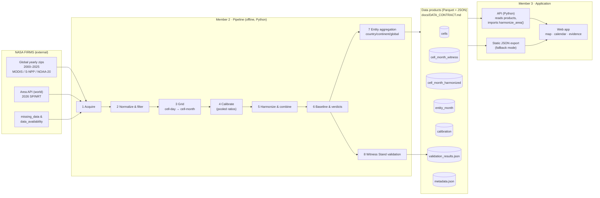

# Architecture: **AS BUILT** (method 0.1.0, contract 0.1.1; refreshed 2026-11-15, T-075)

This document describes the system that exists in the repository. Stack: D-008; layout: D-023; API owner: D-015. Where the build differs from the original proposal, section 8 lists the change and the decision that made it.

## 1. Overview

The system has three layers, with **precompute-heavy** processing and a **thin API**.

## 2. Components and ownership

The last column names the code in `pipeline/`, `api/` or `app/` that implements each component.

| Component | Owner | Responsibility | Input | Output | Code |
|---|---|---|---|---|---|
| Acquire | M2 | Download zips; pull 2026 data via the API; fetch outage tables | FIRMS | `data/raw/` | `download_zips.py`, `pull_api_2026.py`, `check_modis_availability.py` |
| Normalize & filter | M2 | Unzip; unify schema; attach country from file name; filter type and confidence; static-source and night-source masks (D-025) | raw CSV | `data/interim/detections/` (Parquet, by sensor and year) | `normalize.py`, `qa_filters.py`, `night_mask.py`, `night_sources.py`, `country_mapping.py`, `fire_regions.py` |
| Grid | M2 | Fine-grid cell-day presence; aggregate to analysis cell-month per witness and day/night | detections | `cell_month_witness`, `cells` | `gridding.py` |
| Calibrate | M2 | Overlap-period conversion ratios with partial pooling and uncertainty | cell-month | `calibration` | `calibration.py` |
| Harmonize & combine | M2 | Convert each witness; precision-weighted combination with disagreement inflation (day and night separately, one method for every month) | cell-month + calibration | estimates in `cell_month_harmonized` | `harmonize.py` (`harmonize_area()`) |
| Baseline & verdicts | M2 | Baseline percentiles (same calendar month 2003 to 2022); probabilities; verdicts and reason codes (D-028) | harmonized | verdict fields of `cell_month_harmonized` | `verdicts.py` |
| Entity aggregation | M2 | Country, continent and global series through `harmonize_area()` | raw sums + calibration | `entity_month` | `verdicts.py` (`entity_month`) |
| Validation | M2 (Lead reviews) | Witness Stand tests, diagnostics, number check | all products | `validation_results.json`, `docs/validation/` | `validation_*.py`, `validation_integrate.py`, `holdout.py`, `aqua_drift.py`, `saturation.py`, `large_fire.py`, `blindness.py`, `number_check.py` |
| API | M3 (D-015) | Read-only endpoints; custom-area aggregation via `harmonize_area()`; CSV export | products | JSON / CSV | `api/fire_api/` |
| Web app | M3 | Map, selection, calendar, raw/harmonized toggle, evidence panel, anomaly list, export, methods page | API or static JSON | UI | `app/src/` |
| Static export | M3 | Pre-render API responses for preset views (offline copy) | API | `app/public/data/*.json` (generated, never committed) | `api/fire_api/static_export.py` |

## 2a. Directory layout (approved, D-023)

| Folder | Owner | Contents |
|---|---|---|
| `pipeline/` | Member 2 | Acquisition, normalization, gridding, calibration, harmonization (`harmonize_area()`), validation |
| `api/` | Member 3 | FastAPI app; imports `harmonize_area()` from `pipeline/` |
| `app/` | Member 3 | React/Vite web app |
| `data/` | Member 2 (conventions) | Fixtures (committed) and raw/interim/products (ignored) |
| `docs/` | Everyone (via PR) | Documentation |

## 3. Integration boundaries (the rules both workstreams follow)

1. **The only interface between M2 and M3 is the data products in `DATA_CONTRACT.md`, plus the `harmonize_area()` function signature.** M3 never reads raw or interim data. M2 never edits frontend code.
2. **There is a single implementation of the science.** Area aggregation for both preset entities and custom areas calls the same `harmonize_area(cell_ids, months) -> series` function.
   - *Why:* conversion errors are shared by all cells in a calibration stratum. Summing per-cell intervals would understate area uncertainty.
3. **Contract changes:** propose → Lead approves → update `DATA_CONTRACT.md` and bump `contract_version` → then change the code.
4. **Fixtures:** M2 commits small `SYNTHETIC` fixtures under `data/fixtures/`, matching the contract exactly. M3 develops against them until the real products arrive.
5. **Versioning:** every product carries `method_version` and `contract_version`. The API exposes them at `/api/meta`.

## 4. Data flow details

**Acquisition**
- Zips (no login): `https://firms.modaps.eosdis.nasa.gov/data/country/zips/{modis|viirs-snpp|viirs-jpss1}_{YYYY}_all_countries.zip`
- For 2026, the area API with `world` and 5-day windows for `MODIS_SP|NRT`, `VIIRS_SNPP_SP|NRT` and `VIIRS_NOAA20_SP|NRT`.
- See `DATA_SOURCES.md`.

**Normalize:** one unified detection schema:
`sensor, satellite, lat, lon, acq_datetime_utc, daynight, confidence_class, frp_mw, scan_km, track_km, type, version, country (from file name), data_level (SP|NRT)`

**Grid:** fine-grid `cell-day` presence (at most one per fine cell per day per witness per day/night), summed into analysis cell-month counts. Grid sizes are locked (D-009): analysis cell 0.5 degrees, fine cell 0.05 degrees.

**Storage format:** Parquet (Zstandard compression). The contract products in `data/products/` are committed through **Git LFS** (D-027); raw and interim data are never committed. DuckDB reads them in the API and in the pipeline. JSON is used for `metadata` and `validation_results`.

**Export flow:** API `GET /api/export.csv?...` streams the monthly series (raw per witness, harmonized estimate, interval, verdict, reason codes) for the selected entity or custom area. It includes a header block with `method_version`, the data snapshot date and a citation. Raw hotspot points are **not** exported (too large); we link to FIRMS instead.

**Validation pipeline:** each test is a script that reads the products and writes entries to its own file under `data/interim/qa/`; `validation_integrate.py` combines them into `data/products/validation_results.json` (contract shape, scalar `measured` values only, status `PASS | FAIL | NOT_RUN | INCONCLUSIVE`; `--check` verifies the file). The app renders the file as-is. Results and reports: `docs/VALIDATION_PLAN.md` section 4 and `docs/validation/`.

## 5. API (as built, read-only)

Details, status codes and the anomaly order: `api/README.md`. The API computes no science: it selects, filters, joins and orders stored values, and calls `harmonize_area()` for custom areas.

| Endpoint | Returns |
|---|---|
| `GET /api/meta` | `metadata.json` (versions, latest month, provisional months, grid, baseline) |
| `GET /api/entities?type=COUNTRY\|CONTINENT` | Entity list (id, name, bbox) |
| `GET /api/map?year=&month=&layer=verdict\|raw\|harmonized` | Analysis-grid cells for one month |
| `GET /api/map/cells`, `GET /api/map/columns?year=&month=&layer=` | The same cells and month in columns with only the fields the app reads (additive, T-073) |
| `GET /api/series?entity_type=&entity_id=` | Monthly series for a preset entity (country, continent or `GLOBAL`) |
| `POST /api/series/custom` body `{"bbox": [W,S,E,N]}` or `{"polygon": [[lon,lat], ...]}` | Monthly series for a custom area (via `harmonize_area`) |
| `GET /api/evidence?entity_type=&entity_id=&year=&month=` | Evidence panel payload |
| `GET /api/anomalies?year=&month=&limit=` | Entities with an above or below verdict, ordered by probability at the displayed precision, then distance from normal |
| `GET /api/validation` | `validation_results.json` as stored |
| `GET /api/export.csv?entity_type=&entity_id=` or `?bbox=`; `POST /api/export.csv` | CSV of the series (preset area, rectangle or polygon) |

**Columnar map endpoints (T-073).** A map month from `GET /api/map` is 56,238 records, 32 MB raw and about 3 MB gzipped, because every record repeats its keys and the fields the map does not read. The Lead approved (PR #81) an additive pair of endpoints: `GET /api/map/cells` (the ids and bounds of the cells, once) and `GET /api/map/columns` (the month, one column per field, only the fields the app reads, values exactly as stored, no rounding). `GET /api/map` is unchanged, so no response shape and no contract changes. The layout is the one the offline copy already uses (`api/fire_api/columnar.py`); the app decodes it into the same `MapCell` objects (`app/src/api/mapColumns.ts`; the fields it never reads are absent, not invented) and falls back to `GET /api/map` when the API has no columnar endpoint (404). A month is about 1.2 MB gzipped instead of 3.0 (2023-07). Field sets, sizes and the tests that compare every value with `GET /api/map`: `api/README.md`, "Columnar map". The displayed numbers do not change.

## 6. External sources

NASA FIRMS (zips, area API, missing_data/data_availability). Non-NASA: Natural Earth 1:50m admin-0 countries (public domain; country and continent codes) and the GFED4s basis regions (the 14 fire regions used for calibration pooling; T-004). Details are in `DATA_SOURCES.md`.

## 7. Deployment (as built)

- **Primary:** local run (see the README) plus a recorded demo. Nothing is deployed from this repository without the Lead's go-ahead.
- **Offline copy:** the app can run from static files for the preset views, with no API (`app/README.md`, `api/fire_api/static_export.py`); a runtime fallback switches to it if the API cannot be reached. Custom areas need the API.

## 8. Changes from the proposal

| Proposal | As built | Decision |
|---|---|---|
| Sequential witnesses as a possible fallback (Fallback B) | One combination method for every month: day and night combined separately, then added | D-005, T-013 (Lead's rule on PR #45) |
| Aqua stays the reference throughout | Aqua night excluded from 2024-05 (drift), Aqua day kept; months carry `AQUA_DRIFT_ERA` | D-005 |
| Contract 0.1.0 | Contract 0.1.1 (`NOT_HARMONIZED` reason code, entity ids) | D-016, D-026 |
| Products shared outside Git | Products committed through Git LFS | D-027 |
| Verdict thresholds open | Baseline 2003 to 2022, empirical percentiles, 80% probability rule, fixed verdict order | D-028 and its amendment A |
| One ratio per stratum | Partial pooling by stratum, region and global; a v0.2 activity-dependent conversion was built and **not adopted** (pre-registered rule not met) | T-011, D-030 |
| Custom area: bbox (polygon as P1) | Bbox and free polygon | T-044 |
| Validation results written by each test | Entries combined by `validation_integrate.py` into `validation_results.json` (flat `measured` values) | T-027 |
