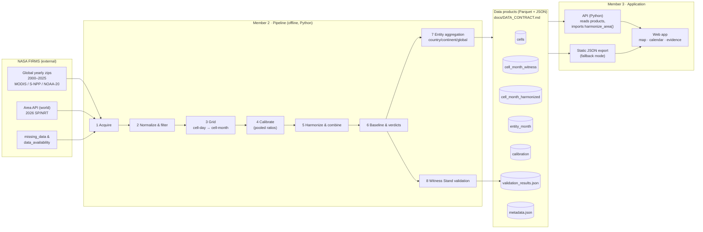

# Architecture: **PROPOSED** (the stack it builds on was approved as D-008 on 2026-11-14; the directory layout T-0D and API owner D-015 are still open)

## 1. Overview

The system has three layers, with **precompute-heavy** processing and a **thin API**.

## 2. Components and ownership

| Component | Owner | Responsibility | Input | Output |
|---|---|---|---|---|
| Acquire | M2 | Download zips; pull 2026 data via the API; fetch outage tables | FIRMS | `data/raw/` |
| Normalize & filter | M2 | Unzip; unify schema; attach country from file name; filter type/confidence; static-source mask | raw CSV | `data/interim/detections/` (Parquet, by sensor/year) |
| Grid | M2 | Fine-grid cell-day presence; aggregate to analysis cell-month per witness × day/night | detections | `cell_month_witness` |
| Calibrate | M2 | Overlap-period conversion factors with partial pooling and uncertainty | cell-month | `calibration` |
| Harmonize & combine | M2 | Convert each witness; precision-weighted combination with disagreement inflation | cell-month + calibration | `cell_month_harmonized` (estimates) |
| Baseline & verdicts | M2 | Baseline percentiles; probabilities; verdicts and reason codes | harmonized | `cell_month_harmonized` (verdict fields) |
| Entity aggregation | M2 | Country/continent/global series via `harmonize_area()` | raw sums + calibration | `entity_month` |
| Validation | M2 (Lead reviews) | Witness Stand tests | all products | `validation_results.json` |
| API | M3 (or M2; D-015) | Read-only endpoints; custom-area aggregation via `harmonize_area()`; CSV export | products | JSON / CSV |
| Web app | M3 | Map, selection, calendar, toggle, evidence, anomaly list, export, methods page | API or static JSON | UI |
| Static export | M3 | Pre-render API responses for preset views | API | `public/data/*.json` |

## 3. Integration boundaries (the rules both workstreams follow)

1. **The only interface between M2 and M3 is the data products in `DATA_CONTRACT.md`, plus the `harmonize_area()` function signature.** M3 never reads raw or interim data. M2 never edits frontend code.
2. **There is a single implementation of the science.** Area aggregation for both preset entities and custom areas calls the same `harmonize_area(cell_ids, months) -> series` function.
   - *Why:* conversion errors are shared by all cells in a calibration stratum. Summing per-cell intervals would understate area uncertainty.
3. **Contract changes:** propose → Lead approves → update `DATA_CONTRACT.md` and bump `contract_version` → then change the code.
4. **Fixtures:** M2 commits small `SYNTHETIC` fixtures under `data/fixtures/`, matching the contract exactly. M3 develops against them until the real products arrive.
5. **Versioning:** every product carries `method_version` and `contract_version`. The API exposes them at `/api/meta`.

## 4. Data flow details

**Acquisition**
- Zips (no login): `https://firms.modaps.eosdis.nasa.gov/data/country/zips/{modis|viirs-snpp|viirs-jpss1}_{YYYY}_all_countries.zip`
- For 2026, the area API with `world` and 5-day windows for `MODIS_SP|NRT`, `VIIRS_SNPP_SP|NRT` and `VIIRS_NOAA20_SP|NRT`.
- See `DATA_SOURCES.md`.

**Normalize:** one unified detection schema:
`sensor, satellite, lat, lon, acq_datetime_utc, daynight, confidence_class, frp_mw, scan_km, track_km, type, version, country (from file name), data_level (SP|NRT)`

**Grid:** fine-grid `cell-day` presence (at most one per fine cell per day per witness per day/night), summed into analysis cell-month counts. Grid sizes are locked at Gate G1 (D-009).

**Storage format:** Parquet (Zstandard compression). Products are partitioned so the API and map can read one month or one region cheaply. JSON is used for `metadata` and `validation_results`.

**Export flow:** API `GET /api/export.csv?...` streams the monthly series (raw per witness, harmonized estimate, interval, verdict, reason codes) for the selected entity or custom area. It includes a header block with `method_version`, the data snapshot date and a citation. Raw hotspot points are **not** exported (too large); we link to FIRMS instead.

**Validation pipeline:** each test is a script/function that reads the products and writes one record per test case to `validation_results.json` (see the contract), with status `PASS | FAIL | NOT_RUN | INCONCLUSIVE`. The app renders this file as-is.

## 5. API (proposed, read-only)

| Endpoint | Returns |
|---|---|
| `GET /api/meta` | `metadata.json` (versions, latest month, provisional months, grid, baseline) |
| `GET /api/entities?type=country\|continent` | Entity list (id, name, bbox) |
| `GET /api/map?year=&month=&layer=verdict\|raw\|harmonized` | Analysis-grid cells for one month |
| `GET /api/series?entity_type=&entity_id=` | Monthly series for a preset entity |
| `POST /api/series/custom` body `{bbox}` (P1: `{polygon}`) | Monthly series for a custom area (via `harmonize_area`) |
| `GET /api/evidence?entity_type=&entity_id=&year=&month=` | Evidence panel payload |
| `GET /api/anomalies?year=&month=&limit=` | Ranked entities by probability above/below normal |
| `GET /api/validation` | `validation_results.json` |
| `GET /api/export.csv?...` | CSV of the series |

## 6. External sources

NASA FIRMS (zips, area API, missing_data/data_availability). Non-NASA: Natural Earth admin-0 boundaries (public domain), and a fire-region mask (GFED basis regions; access to be verified, T-004; fallback: UN subregions from country names). Details are in `DATA_SOURCES.md`.

## 7. Deployment (proposed)

- **Primary:** local run plus a recorded demo.
- **Optional:** static frontend on a free host, and the API on a free container host. Static fallback mode keeps preset views working if the API host is down.
