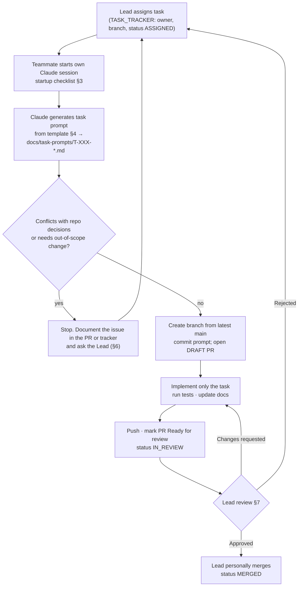

# Team Workflow: From Task Assignment to Approved Merge

**Central principle:** teammates execute assigned tasks. Their Claude sessions generate task-specific prompts and help with implementation. Every task is submitted through a Pull Request. **The Project Lead reviews and controls every merge into `main`.**

This document is the authoritative description of the collaboration process (decision D-017). Where another document disagrees, this one wins. Report the conflict to the Lead.

---

## 1. Roles in the workflow

| | Member 1: Project Lead | Member 2: Data & Science | Member 3: App & UI |
|---|---|---|---|
| Assigns tasks | **Yes** | No | No |
| Implements | No (supervises) | Assigned data/science tasks only | Assigned app/API/UI tasks only |
| Own Claude session | Yes (planning, review support) | Yes | Yes |
| Opens PRs | For bookkeeping or docs if needed | Yes, one per task | Yes, one per task |
| Reviews PRs | **Yes, every PR** | No (may comment if asked) | No (may comment if asked) |
| Merges into `main` | **Only the Lead** | Never | Never |

AI assistants (any Claude session, any account) **never** merge PRs, approve PRs, or push to `main`. The one exception: the Lead's own session may run a merge only when the Lead explicitly instructs it for a specific PR in that moment.

---

## 2. End-to-end process



### Step-by-step

1. **Assignment (Lead).** In `docs/TASK_TRACKER.md` the Lead sets the task's **Owner**, **Branch** name and status `ASSIGNED`. Tasks that depend on an unapproved decision (e.g. the tech stack, D-008) **cannot** be assigned for implementation until that decision is approved.
2. **Session start (teammate).** The teammate opens their own Claude Code session in their clone of the repository. Claude runs the startup checklist (§3).
3. **Task prompt (teammate's Claude).** Claude reads the relevant documents and writes a self-contained implementation prompt from the template (§4). It saves the prompt to `docs/task-prompts/T-XXX-<short-name>.md`. The teammate checks that it matches the assignment. **The prompt may not add work beyond the tracker entry.**
4. **Branch + draft PR.**
   - `git switch main && git pull`, then `git switch -c <branch from the tracker>`.
   - Commit the task prompt as the first commit.
   - Push, and open a **draft PR** against `main`, so the Lead can catch scope problems early.
5. **Implementation.** The teammate, helped by Claude, implements **only** the task described in the prompt, runs the required tests, and updates documentation (§5).
6. **Ready for review.** Push the final commits, fill in the PR template, mark the PR *Ready for review*, and set the tracker status to `IN_REVIEW` in the same PR.
7. **Review (Lead).** The outcome is *Approved*, *Changes requested* or *Rejected* (§7).
8. **Changes requested.** Fix things **in the same PR and on the same branch**. Do not open a new PR. Re-request review.
9. **Merge (Lead only).** The Lead merges, deletes the branch, and sets the tracker status to `MERGED` (§8).

---

## 3. Mandatory Claude session startup checklist

Every Claude session, for every teammate and every account, must do this before any work:

1. Read `CLAUDE.md`.
2. Read `README.md`.
3. Read `docs/HANDOFF.md`.
4. Read `docs/TEAM_ROLES.md`.
5. Read `docs/TASK_TRACKER.md`.
6. Read the technical and scientific documents relevant to the task (`ARCHITECTURE.md`, `DATA_CONTRACT.md`, `SCIENTIFIC_METHODOLOGY.md`, `TECH_STACK.md`, `DECISION_LOG.md`, `VALIDATION_PLAN.md`), and this file.
7. Check the Git state: `git status`, `git branch --show-current`, `git log --oneline -10`, `gh pr list`.
8. **Confirm the assigned task and its boundaries with the teammate:** the task ID, owner, branch, acceptance criteria, and what must not be touched.
9. If the task conflicts with repository decisions, depends on an unapproved decision, or is not in the tracker: **stop and ask for clarification.** Do not guess.

No session may assume knowledge from a previous session or another account. All project context lives in repository Markdown files.

---

## 4. Task prompt template

Claude fills in **every** section from the repository documents and saves the result as `docs/task-prompts/T-XXX-<short-name>.md`. Vague prompts ("build the dashboard", "process the NASA data") are not acceptable. Every section must be concrete and checkable.

```markdown
# Task prompt: T-XXX <task title>

> Prepared for: Member <n> · Date: YYYY-MM-DD · Based on main @ <commit SHA>
> Source of truth: docs/TASK_TRACKER.md row T-XXX. This prompt adds no scope beyond it.

## 1. Project context
<3–6 sentences: the challenge, the product (Many Witnesses + Witness Stand, global scope),
and where this task fits in the pipeline/app. Cite PROJECT_PLAN.md.>

## 2. Task objective
<one precise paragraph: what will exist when the task is done.>

## 3. Assigned responsibility
- Task ID / priority: T-XXX / P0
- Owner: Member <n> (<role>)
- Reviewer and merger: Member 1 (Project Lead)
- Dependencies (must be MERGED first): <task IDs or "none">

## 4. Relevant files and directories
- Read: <exact paths>
- Create/modify: <exact paths, nothing else>

## 5. Approved technologies
<exact items from TECH_STACK.md "Final approved stack", with versions.
If the stack is not approved, write "BLOCKED: D-008 not approved" and stop.>

## 6. Architecture and data contract
<relevant ARCHITECTURE.md components and boundaries; exact DATA_CONTRACT.md products and fields
used or produced; contract_version.>

## 7. Inputs
<exact inputs: files, fixture paths, API endpoints, env variables (names only, never values).>

## 8. Expected outputs
<exact outputs: files/tables/endpoints/UI elements, with schemas or field lists.>

## 9. Implementation requirements
<numbered, specific requirements, including the scientific rules from SCIENTIFIC_METHODOLOGY.md.>

## 10. Constraints: do not modify
- Do not change the tech stack, architecture, scientific methodology or data contract.
- Do not edit files outside §4 "Create/modify".
- Do not touch the other workstream's directories: <list>.
- No secrets, no large data files, no direct pushes to main, no self-merge.
- Do not mark unverified scientific claims as validated.
- <task-specific constraints>

## 11. Acceptance criteria
<copied from TASK_TRACKER.md, made measurable.>

## 12. Required tests
<exact tests to write or run and the commands to run them; expected results.>

## 13. Documentation updates
<exact files and sections to update in this PR (always TASK_TRACKER.md row T-XXX).>

## 14. Git branch and PR instructions
- Branch: `<from tracker>` created from the latest `main`
- First commit: this prompt file
- Open a DRAFT PR early; title "T-XXX: <title>"; fill in .github/pull_request_template.md
- Mark Ready for review only when §11 and §12 are satisfied
- Never merge; wait for the Project Lead
- Commit with your own Git identity; no AI names or attribution in commits, PR text or branch names (D-020)

## 15. Out-of-scope or blocking issues
If anything requires a change outside this prompt: stop, describe it under
"Scope issues" in the PR, set the tracker status to BLOCKED, and ask the Project Lead.
```

**Rules for generating prompts:**
- Claude must not invent requirements, technologies or acceptance criteria that are not in the repository documents.
- If the documents are ambiguous, the prompt lists the ambiguity under §15 and asks the Lead. It does not decide.
- One prompt per task. If a task looks too large, propose a split to the Lead. Do not split it unilaterally.

---

## 5. Implementation rules (all teammates and their Claude sessions)

**Never:**
- change the approved tech stack, the architecture, the scientific methodology or the shared data contract without the Lead's approval (logged in `DECISION_LOG.md`)
- modify another member's workstream unless the task explicitly says so
- commit secrets, API keys, `.env` files or large data
- push to `main`, merge your own PR, or approve PRs
- mark unverified scientific claims as validated; validation statuses stay `NOT_RUN` until a test has actually run
- include any AI tool's name or AI-generated attribution in commits, PRs, branch names, code comments, documentation credits or metadata (D-020); commit only with your own Git identity

**Always:**
- implement only the assigned task
- keep commits small and meaningful (`CONTRIBUTING.md`)
- update documentation in the same PR
- use clearly labelled `SYNTHETIC` data when real data isn't available, and never present it as results

---

## 6. Requesting an out-of-scope change

1. Stop work on the out-of-scope part.
2. Describe it in the PR under "Scope issues": what is needed, why, which files or decisions are affected, and the options.
3. Set the task's tracker status to `BLOCKED` (or continue the in-scope part if that's possible).
4. Notify the Lead. The Lead decides and logs it in `DECISION_LOG.md`. A contract change needs a `contract_version` bump before any code relies on it.
5. Resume only after approval is recorded.

---

## 7. Project Lead review

**Checklist** (also in `CONTRIBUTING.md`):
1. Task requirements fulfilled, matching the prompt and the tracker acceptance criteria.
2. Follows the approved architecture.
3. Respects the data contract (fields, types, enums, `contract_version`).
4. Scientific calculations and interpretations are correct (hotspots ≠ fires; uncertainty; no unsupported claims).
5. Code is readable and maintainable.
6. Appropriate tests were run, and the results are shown in the PR.
7. Errors and edge cases are handled (nulls, outages, zero baselines, no detections, provisional months).
8. Integrates with the other workstream.
9. Documentation updated.
10. No accidental secrets or large files.
11. No regressions.

**Outcomes** (recorded with GitHub's review feature and in the tracker's *Review* column):

| Outcome | GitHub action | Tracker | Next step |
|---|---|---|---|
| **Approved** | "Approve" review | Review `APPROVED` | The Lead merges personally |
| **Changes requested** | "Request changes" with specific comments | Status `CHANGES_REQUESTED` | The teammate fixes it in the same PR |
| **Rejected** | Comment explaining why; close the PR | Status `REJECTED` | The task is reconsidered and reassigned (possibly redefined) |

The Lead may use their own Claude session to *help* review (summaries, diff checks, running tests). The decision and the merge are the Lead's.

---

## 8. Merging (Lead only)

- Merge only PRs with an *Approved* review from the Lead.
- Preferred method: **squash and merge**, which gives one commit per task on `main`. The squash title is `T-XXX: <title> (#PR)`.
- Delete the branch after merging.
- Bookkeeping after the merge: set the tracker status to `MERGED` and add the PR link.

### Lead bookkeeping commits (exception, D-018)
The Lead may commit **directly** to `main` only for bookkeeping in `docs/TASK_TRACKER.md`, `docs/DECISION_LOG.md`, `docs/PROGRESS_LOG.md` and `docs/HANDOFF.md`: assignments, statuses, approvals, logs. All other changes, including the Lead's own substantive docs, go through PRs.

---

## 9. Task statuses

`TODO` → `ASSIGNED` → `IN_PROGRESS` → `IN_REVIEW` → (`CHANGES_REQUESTED` → `IN_REVIEW`)* → `MERGED`.
Also: `BLOCKED`, `REJECTED`, `CUT`.
The *Review* column values are `—`, `PENDING`, `CHANGES_REQUESTED`, `APPROVED` and `REJECTED`.

**To avoid merge conflicts in the tracker:** a teammate's PR edits **only its own task row**. The Lead does all other tracker edits.

---

## 10. How `main` is protected: policy vs actual GitHub settings

| Layer | Status (verified 2026-11-14) |
|---|---|
| **Documented policy** (this file, `CONTRIBUTING.md`, `CLAUDE.md`) | **In force.** No direct pushes and no self-merges; only the Lead merges |
| **Local pre-push guard** (`.githooks/pre-push`) | Available. Each member enables it once with `git config core.hooksPath .githooks`. It blocks accidental pushes to `main` from that clone. It is a safety net, **not** enforcement: it can be bypassed with `--no-verify` |
| **GitHub branch protection / rulesets on `main`** | **Not configured.** The API reports "Branch not protected" and no rulesets exist. Per GitHub's documentation, protected branches and rulesets on *private* repositories need a paid plan (Pro/Team), and collaborators on a personal-account repository get write access, so they **can technically push to `main`** |
| **Enabling technical protection** | Requires the Lead's explicit decision (D-019, OPEN). Options: (a) upgrade to GitHub Pro and protect `main` (require a PR + 1 approval, block force pushes); (b) make the repository public, where protection is free (this conflicts with the private requirement); (c) stay with policy + local guard + Lead monitoring. No GitHub setting has been changed |

**Lead monitoring (while there is no technical protection):** check `git log origin/main` at each review checkpoint. Any commit on `main` not from a merged PR or a Lead bookkeeping commit gets investigated and, if needed, reverted through a PR.
